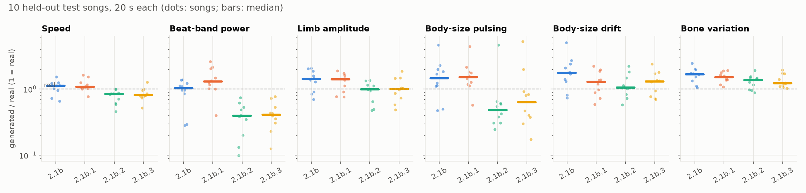
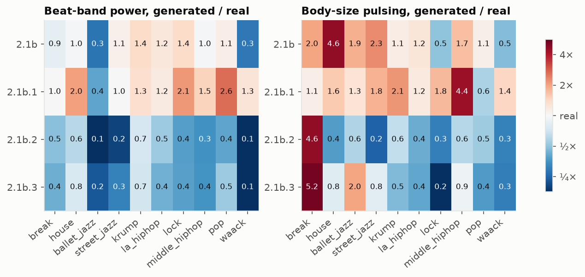
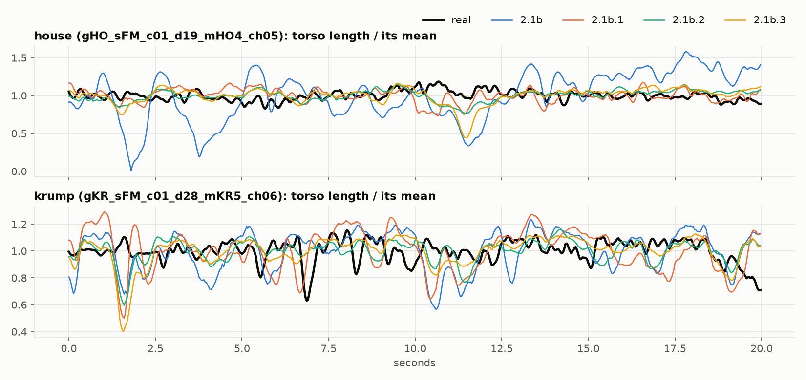
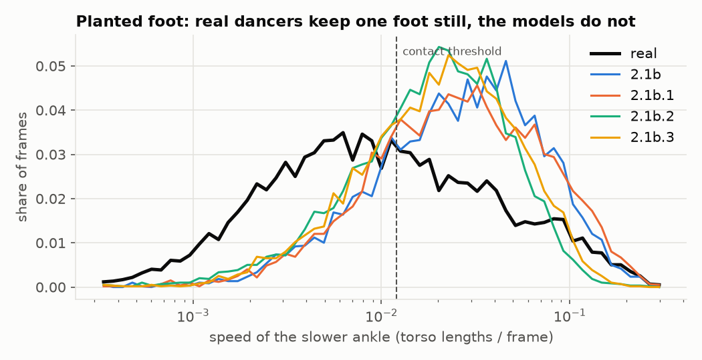

# The 2.1b family: base, larger, and the new energy loss

| Run | Change from 2.1b | SageMaker job |
|---|---|---|
| 2.1b | base: 7.1M, bone 1.0, energy 0.25 (speed + amplitude, all noise levels) | `c-small-co-f9ed5641` |
| 2.1b.1 | 46.9M (d 512, ff 1024, 8 layers) | `base-large-2f9d37ca` |
| 2.1b.2 | energy 0.1, speed only, size-normalized, t < 500, Gaussian shape (σ 0.3) | `e-gauss-b9934c0c` |
| 2.1b.3 | same as 2.1b.2 with the squared shape | `e-square-5f731354` |

## Full evaluation (held-out test songs, 769 windows)

Same protocol as `reports/2026-11-19_eval_2x` (seed 0, 50 DDIM steps, eta 1, guidance 2).

| Run | Kinetic FID ↓ | Pose FID ↓ | Speed | BeatPow | BoneCV (real 0.17) | Torso drift 20 s (real 0.105) |
|---|---:|---:|---:|---:|---:|---:|
| [2.1b](../2026-11-19_eval_2x/metrics/run_2.1b_test.json) | 28.6 | 42.2 | 1.13 | **0.98** | 0.27 | 0.178 |
| [2.1b.1](../2026-11-19_eval_2x/metrics/run_2.1b.1_test.json) | 23.7 | 33.5 | 1.23 | 1.39 | 0.27 | **0.124** |
| [2.1b.2](../2026-11-19_eval_2x/metrics/run_2.1b.2_test.json) | **22.0** | **22.5** | 0.84 | 0.44 | **0.23** | 0.127 |
| [2.1b.3](../2026-11-19_eval_2x/metrics/run_2.1b.3_test.json) | 22.7 | 23.2 | 0.87 | 0.45 | 0.23 | 0.141 |

On the advanced validation dances (440 windows) the kinetic FIDs are 27.4, 54.2, 20.9 and 23.7, and BeatPow is
1.15, 1.60, 0.49 and 0.57.

## Side-by-side videos

[`videos/compare_<genre>_<video>.mp4`](https://huggingface.co/SizheZ03/beat2body-runs/tree/main/reports/2026-11-19_2.1b_variants/videos) (on Hugging Face) contains one advanced test song per genre (all 10 are held-out songs), 20 s
with music. The panels are real | 2.1b | 2.1b.1 | 2.1b.2 | 2.1b.3. Every model uses the same seed, and the panel
border flashes on the beat. The generated keypoints are in [`npz/`](https://huggingface.co/SizheZ03/beat2body-runs/tree/main/reports/2026-11-19_2.1b_variants/npz).

## Per-song statistics (the same 10 dances)

Each value is generated / real for the same song (1 = real). The numbers are in `stats.csv` and the medians in
`stats.json`.

| Median over 10 songs | Speed | Beat-band power | Limb amplitude | Size pulsing (1–4 Hz) | Size drift | Bone variation |
|---|---:|---:|---:|---:|---:|---:|
| 2.1b | 1.12 | 1.03 | 1.42 | 1.46 | 1.75 | 1.68 |
| 2.1b.1 | 1.09 | 1.30 | 1.40 | 1.51 | 1.29 | 1.51 |
| 2.1b.2 | 0.84 | 0.39 | **0.99** | 0.48 | **1.06** | 1.36 |
| 2.1b.3 | 0.81 | 0.41 | 1.01 | 0.64 | 1.31 | **1.23** |

Where the movement sits in frequency (share of pelvis-centred motion power) and how often the body collapses
(torso shorter than half its median):

| | < 1 Hz | 1–4 Hz (beat band) | Collapsed frames |
|---|---:|---:|---:|
| Real | 0.77 | **0.22** | 0.9% |
| 2.1b | 0.89 | 0.11 | 3.2% |
| 2.1b.1 | 0.81 | **0.18** | **1.4%** |
| 2.1b.2 | 0.91 | 0.09 | 2.7% |
| 2.1b.3 | 0.91 | 0.09 | 2.6% |

## Findings

1. **2.1b's real-looking energy came mostly from things we do not want.** Its limbs swing 1.4× wider than real,
   and its body size pulses 1.5× more than real at 1–4 Hz and drifts 1.75× more over 20 s. In the house dance the
   torso shrinks to nearly zero twice in the first 4 s, which shows on screen as the figure folding up. Its
   beat-band power matches real only because the oversized motion makes up for too little rhythm: just 11% of its
   motion power is in the beat band, against 22% for real dancers.
2. **The new energy loss (2.1b.2 / 2.1b.3) fixes the size and amplitude.** Limb amplitude is now real (0.99 and
   1.01), size pulsing is below real, and 2.1b.2's slow size drift is real (1.06). That explains the large FID
   gains, especially pose FID (42 → 22.5). The dancer now *reaches* real poses but moves between them slowly:
   91% of its motion power is below 1 Hz, so beat-band power is 0.4× real. In the videos it sways and
   steps rather than hitting moves on the beat. Waacking, ballet jazz and street jazz are the flattest (0.1–0.2×).
3. **Gaussian vs square:** the differences are small. The Gaussian gives the steadier body size (drift 1.06 vs
   1.31, slightly better FIDs). The square keeps a little more speed in some genres (house, pop). Neither restores
   beat-band power, because the loss now constrains overall speed (mostly the slow motion) and nothing
   asks for 1–4 Hz motion specifically.
4. **The larger model (2.1b.1) has the most realistic rhythm:** 18% of its motion is in the beat band (real 22%),
   it collapses the least (1.4%), and it drifts less than 2.1b. It still inherits the old loss's oversized limbs
   (1.4×) and size pulsing, and it overshoots beat-band power on house, lock and pop (2–2.6×).
5. **Break dance is an outlier for the new loss:** size pulsing rises to 4.6–5.2× real. Break has floor work,
   where the torso is foreshortened, and the size-normalized loss stops penalizing those size changes.

## Suggested next runs

- **2.1b.4:** 2.1b.2 + a loss on **beat-band (1–4 Hz) power of the size-normalized limbs**, rather than on raw
  speed or amplitude. This targets exactly what is missing without rewarding wide limbs or size pulsing.
  A cheaper first try is 2.1b.2 with the amplitude term back on (`--energy-amplitude 1`, weight 0.25).
- **2.1b.5:** the winning energy loss on the 46.9M model, which has the better rhythm.

Reproduce: `python reports/2026-11-19_2.1b_variants/make_comparison.py` (about 10 min on MPS; the dances are
cached in `npz/`, and `--no-video` recomputes only the statistics and figures).

## Whole-body shifting and foot sliding

`python reports/2026-11-19_2.1b_variants/sliding.py` (the same 10 songs) writes `sliding.json` and
`figures/sliding.png`. Speeds are in torso lengths per frame.

| | Real | 2.1b | 2.1b.1 | 2.1b.2 | 2.1b.3 |
|---|---:|---:|---:|---:|---:|
| Root speed (whole-body travel) | 0.035 | 0.037 | 0.039 | 0.029 | 0.032 |
| Root jitter (frame-to-frame change) | 0.014 | 0.021 | 0.020 | 0.016 | 0.019 |
| Slower ankle's speed (median) | 0.014 | 0.030 | 0.031 | 0.022 | 0.024 |
| Frames with no foot planted | 44% | 77% | 76% | 70% | 71% |
| Ankle speed when the model says "planted" | 0.0095 | 0.040 | 0.030 | 0.026 | 0.029 |

- Overall travel is real. The root is 1.2–1.5× more jittery, which reads as the whole figure shifting.
- The feet slide: real dancers usually keep one foot still, and the models rarely do. Even when a model's own
  contact output says a foot is planted, that foot moves 3–4× faster than a real planted foot. EDGE's foot loss
  applies only where the model predicts contact, so it is nearly inactive.
- Stitching the 150-frame windows is not the cause. Overlapping windows disagree by about 0.1 torso lengths on the
  root, which spreads over a 75-frame cross-fade, and the root is no faster in the middle of the fades.
- Fixes, cheapest first: contact-driven foot locking after sampling; a foot loss on the real contact labels (slower
  ankle, higher weight) with a root-acceleration penalty.
