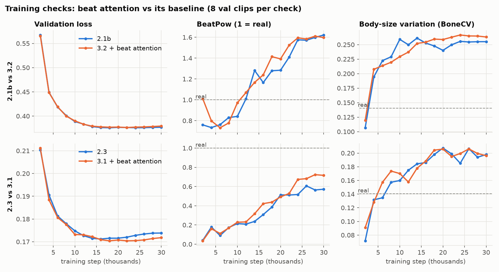
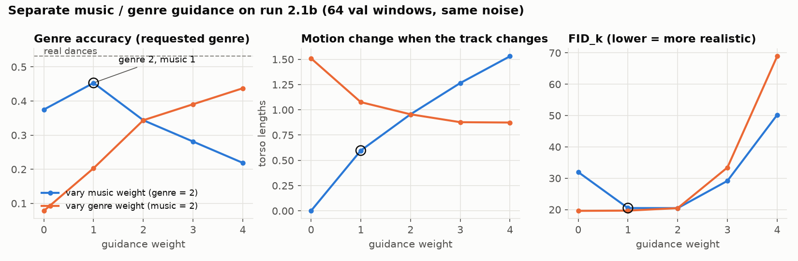
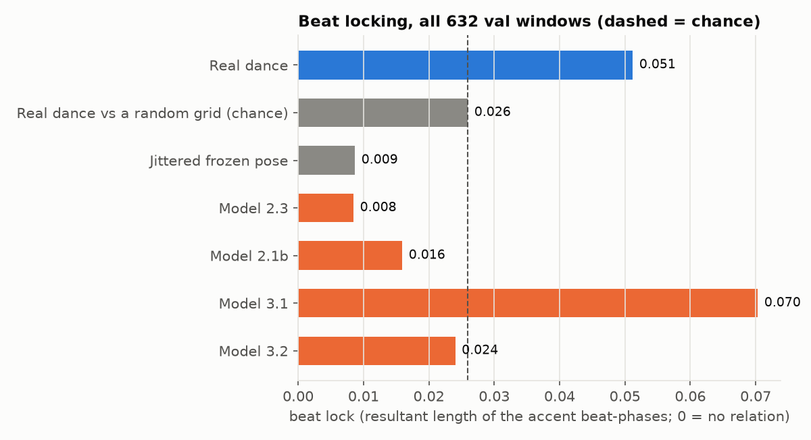
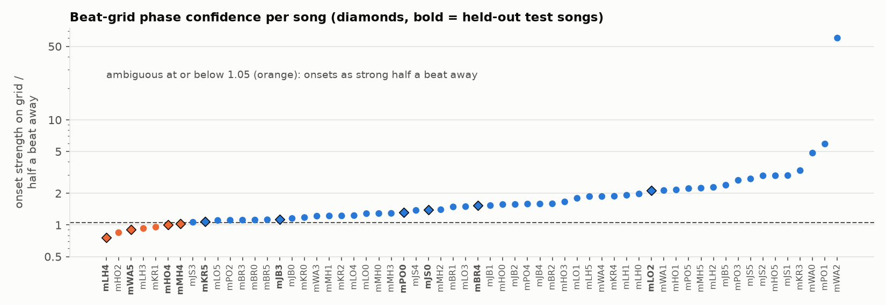

# Beat2Body evaluation of runs 2.1–2.3

All four baseline runs have finished both evaluations. See the [full benchmark tables and protocol](benchmark.md) and the [metrics CSV](summary.csv).

| Run | Split | Windows | Kinetic FID | Pose FID | Speed | BeatPow | Torso CV (20 s) |
|---|---|---:|---:|---:|---:|---:|---:|
| [2.1b](metrics/run_2.1b_val.json) | Advanced validation | 440 | 27.40 | 68.42 | 1.039 | 1.150 | 0.186 |
| [2.1b](metrics/run_2.1b_test.json) | Held-out songs | 769 | 28.61 | 42.24 | 1.127 | 0.977 | 0.178 |
| [2.2](metrics/run_2.2_val.json) | Advanced validation | 440 | 27.04 | 26.82 | 0.640 | 0.412 | 0.079 |
| [2.2](metrics/run_2.2_test.json) | Held-out songs | 769 | 25.01 | 15.57 | 0.719 | 0.446 | 0.101 |
| [2.3](metrics/run_2.3_val.json) | Advanced validation | 440 | 45.50 | 30.23 | 0.533 | 0.210 | 0.077 |
| [2.3](metrics/run_2.3_test.json) | Held-out songs | 769 | 33.86 | 22.07 | 0.555 | 0.205 | 0.078 |
| [2.1](metrics/run_2.1_val.json) | Advanced validation | 440 | 36.95 | 67.33 | 1.194 | 1.712 | 0.186 |
| [2.1](metrics/run_2.1_test.json) | Held-out songs | 769 | 22.52 | 41.85 | 1.192 | 1.314 | 0.223 |

---

## Decision: run 2.1b is the base model

Run 2.1b has real-dance energy (speed ~1.0–1.1, BeatPow ~1.0) with a good kinetic FID, and is the base for future
experiments: each new variant = 2.1b's settings + one change, compared against the 2.1b rows above. Its main
weakness is body-size variation: BoneCV 0.27 on test vs 0.17 real, 20 s torso variation 0.18 vs 0.10 real.

2.1b settings: 7.1M (d 256, ff 512, 4 layers, 4 heads), `--recipe edge`, bone loss 1.0, energy loss 0.25,
body scale per dancer, warm-up 1000, gradient clip 1.0, cosine LR, 30k steps, checkpoint = lowest val loss.

## Beat-relative attention: runs 3.1 and 3.2 (dropped)

Each run is a baseline + `--beat-attn`, same seed: per layer and head, a learned bias on the music frames by their
offset from the motion frame in fractions of a beat, and by their beat phase (zero at the start = the baseline).
3.2 = 2.1b + beat attention (`ba-co-48ba8a4d`), 3.1 = 2.3 + beat attention (`ba-pure-8a92bce1`). Same evaluation
settings as the tables above.

| Run | Split | Kinetic FID | Pose FID | Speed | BeatPow | BoneCV | Torso CV (20 s) |
|---|---|---:|---:|---:|---:|---:|---:|
| [3.2](metrics/run_3.2_val.json) | Advanced validation | 27.59 | 71.50 | 1.067 | 1.185 | 0.250 | 0.167 |
| [3.2](metrics/run_3.2_test.json) | Held-out songs | 41.81 | 33.42 | 1.270 | 1.198 | 0.268 | 0.172 |
| [3.1](metrics/run_3.1_val.json) | Advanced validation | 37.79 | 40.54 | 0.599 | 0.326 | 0.192 | 0.085 |
| [3.1](metrics/run_3.1_test.json) | Held-out songs | 30.93 | 35.13 | 0.647 | 0.309 | 0.191 | 0.089 |

Beat-shift probe, 632 val windows (beat lock: real 0.051, random grids 0.026):

| Run | Beat lock | Follow, ¼ beat | Follow, ½ beat |
|---|---:|---:|---:|
| 2.3 | 0.008 | −0.90 ± 0.79 | 0.87 ± 0.51 |
| 3.1 | 0.070 | 0.63 ± 0.59 | 0.99 ± 0.87 |
| 2.1b | 0.016 | 0.04 ± 0.60 | −0.38 ± 0.41 |
| 3.2 | 0.024 | 1.89 ± 1.34 | −0.97 ± 0.67 |

- On the base model, beat attention changed nothing measurable (3.2 vs 2.1b: same validation metrics, chance-level
  beat lock); on test its kinetic FID was worse (41.8 vs 28.6). Dropped from the base model.
- 3.1 is the only model with beat lock above chance (0.070), but the shift test is within noise and its lock falls
  back to chance when the grid is moved; one seed. A second seed would show whether this is real.

## Separate music and genre guidance

Sampling can now weight the music and the genre separately (`--music-guidance`, `--genre-guidance`):
x0 = uncond + w_genre (genre_only − uncond) + w_music (joint − genre_only). Equal weights reproduce the single
guidance weight (2) used so far. Sweep on run 2.1b, 64 advanced val windows, the same noise for every setting
(`python -m beat2body probe guidance`):

- Both weights work as intended: the motion changes with the track in proportion to the music weight (0 = identical
  motion for any track) and moves toward the requested genre with the genre weight.
- The two compete: a higher music weight lowers genre accuracy.
- **Genre 2, music 1** (circled) raises genre accuracy from 0.34 to 0.45 (real dances: 0.53 with the same
  nearest-centroid classifier) at an unchanged FID_k (20.5). Weights above 3 make FID_k much worse.
  To confirm on the test songs before making it the default.
- No guidance setting improves beat locking: guidance changes *what* moves, not *when*.

Run 2.3 shows the same pattern (genre accuracy 0.34 → 0.45 at genre 2, music 1; FID_k 38.2 → 37.5).

## Beat timing: calibration of the beat-shift probe

`python -m beat2body probe beat-shift` moves the beat grid by ¼ and ½ beat (same audio, tempo, genre and seed)
and measures how far the motion accents move. Calibration on all 632 val windows:

- The accent detector (the one BAS uses) is weak: real dances lock to their grid at only 0.051, against 0.026 by
  chance.
- Neither model locks to the beat: 2.3 (0.008) and 2.1b (0.016) are below chance, like a jittered frozen pose.
  Their response to a shifted grid is within noise (follow −0.9 ± 0.8 and 0.9 ± 0.5 for 2.3; 0.0 ± 0.6 and
  −0.4 ± 0.4 for 2.1b; 1 = follows fully).
- So the probe can show a clear improvement (lock well above 0.026 and follow near 1), not a small one.

## Beat-grid phase is uncertain for 7 of 60 songs

Beats are a grid at each song's published AIST tempo (all 60 match); the grid's phase is estimated from the audio.
For 7 songs, onsets are as strong half a beat away from the grid as on it:

mHO2, mHO4, mKR1, mLH3, mLH4, mMH4 and mWA5 (four of them test songs: mHO4, mLH4, mMH4, mWA5). A half-beat error
flips the model's beat-phase input and the reference for BAS and the beat-shift probe on those songs. Not fixed for
now; the test results will show whether these songs score differently.

---

Figures: `python reports/2026-11-19_eval_2x/make_figures.py`.
