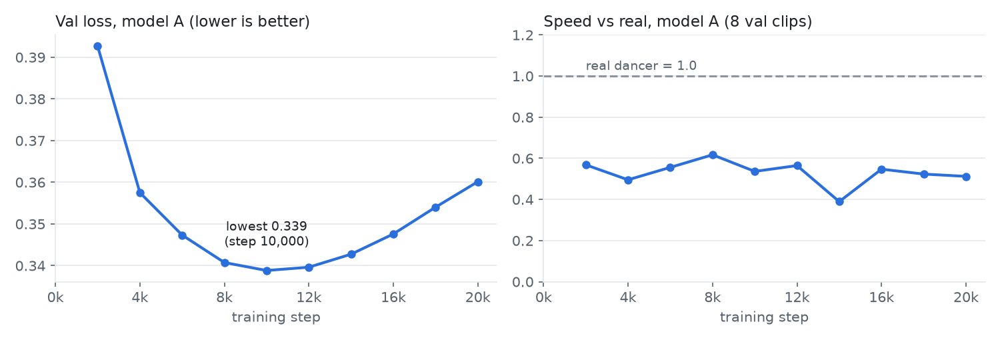
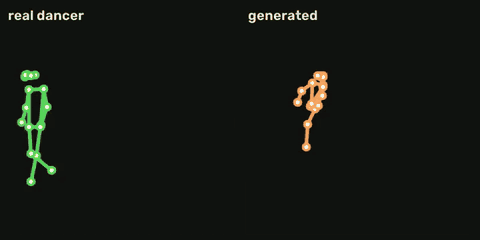
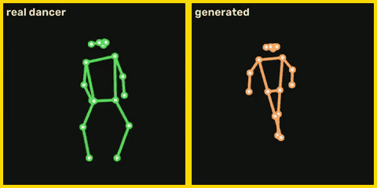
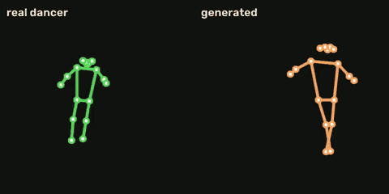
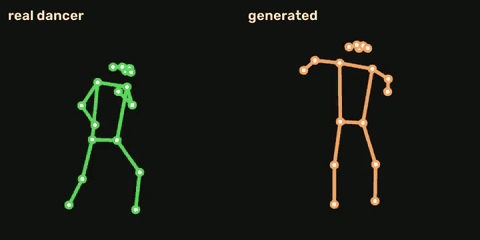
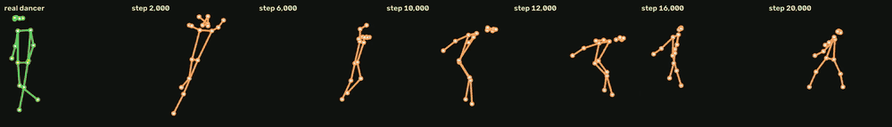
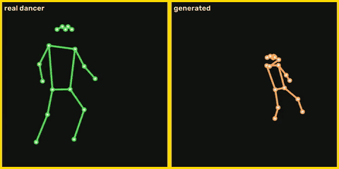
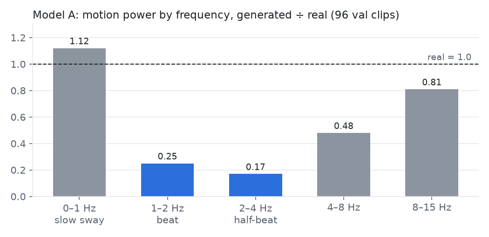

# Progress report: 2D music-to-dance, 19 Nov 2026

**Status:** we have a working 2D EDGE-style diffusion model trained on AIST advanced dances. The body
no longer drifts in size. The main open problem is energy: generated dances sway slowly and miss most
of the movement on the beat. We know why, and three runs on AWS now test the fixes.

Contents: [1. Summary](#1-summary) · [2. Data](#2-data) · [3. Model](#3-model) ·
[4. Training runs](#4-training-runs) · [5. Results and videos](#5-results-and-videos) ·
[6. Why the dances lack energy](#6-why-the-dances-lack-energy) · [7. Fixes in progress](#7-fixes-in-progress) ·
[8. Next steps](#8-next-steps) · [9. Reproduce](#9-reproduce) · [Files in this folder](#files-in-this-folder)

---

## 1. Summary

| Area | State |
|---|---|
| Data | Complete for the chosen scope: all 210 AIST advanced dances (front camera), 3 pose tools, checked against AIST's official file list. Public on Hugging Face (`SizheZ03/AISTDance_{dwpose,openpose,mediapipe}`). |
| Beat labels | Fixed: librosa's tempo was wrong for 10 of 60 songs. The beat grid now uses AIST's published tempos. |
| Model | 2D replica of EDGE (Tseng et al., CVPR 2023): transformer diffusion with music cross-attention, plus genre, root motion, foot contact and beat phase. Full size 46.9M parameters; a small 7.1M version has been trained so far. |
| Body-size drift | Fixed. With per-video scale normalization and a projected bone-length loss, the 20 s dances keep a steady body size: torso variation 0.111, against 0.103 for real dancers (it was 0.134 before the fix). |
| Realism | FID_p 55.5 → 23.1 and FID_k 52.8 → 43.7 from the first model to model A. |
| Energy | **Open problem.** Model A moves at 0.53× real speed and has only 0.26× real's movement on the beat (1–4 Hz). |
| Overfitting | Mild: val loss is lowest at step 10k (0.339) and ends at 0.360 at 20k. It does not explain the low energy. |
| In progress | 3 AWS jobs testing the energy fixes (z-score normalization, v-prediction, energy loss) against a control. |

## 2. Data

**Source.** [AIST Dance Video Database](https://aistdancedb.ongaaccel.jp/) (Tsuchida et al., ISMIR 2019).
We use the **advanced dances** (`sFM`, each dancer's own choreography, about 52 s, 64 beats) from the
**front camera** (`c01`): 10 genres × 21 videos = 210 videos on 60 songs (6 per genre, 80–130 BPM;
House 110–135 BPM).

**Completeness check (19 Nov).** Our videos and keypoints match AIST's official list exactly:

| | AIST list | We have |
|---|---|---|
| Advanced dances, front camera | 210 | 210 videos, 0 missing |
| DWPose / OpenPose / MediaPipe keypoints | 210 each | 210 each |

**Not used yet** (the full database has 13,940 videos):

| Set | Front-camera videos | Fit for this project |
|---|---|---|
| Basic dances (`sBM`, genre basics in 4 styles, about 23 s) | 1,200 (120 per genre, same 60 songs) | **Yes**: the planned next data step, 6× more sequences |
| Other camera angles (`c02`–`c09`) | 8 × the above | Later: same movement from other viewpoints (2D augmentation) |
| Group, moving camera, showcase, cypher, battle | – | No: several dancers or a moving camera |

**Pipeline** (`python -m beat2body all`): frames at 30 fps → 2D pose (COCO-17) with DWPose (main),
OpenPose and MediaPipe → cleaning (outliers, gap filling, Savitzky–Golay smoothing) → audio features
(EDGE's 35 + beat phase) → 5 s clips.

**Split.** One song per genre is held out as the final **test** set (never trained on). The remaining
videos are split by video into train and val (85 / 15):

| Split | Videos | 5 s clips |
|---|---|---|
| Train | 145 | 2,155 |
| Val | 29 | 440 |
| Test (held-out songs) | 36 | 489 |

**Beat-label fix.** librosa's beat tracker picked the wrong tempo for 10 of 60 songs (often half or
double). The beat grid now uses AIST's published tempo for each song. The phase comes from librosa where
its tempo was right, and from an onset-envelope fit otherwise. `python -m beat2body audit` checks this.
Phase is still uncertain for 4 songs (mHO4, mJS3, mKR1, mLH4).

## 3. Model

A 2D replica of [EDGE](https://edge-dance.github.io/), kept as close to the paper as possible:

| Part | Setting |
|---|---|
| Motion per frame (38 values) | 2 ankle contacts, 2 root (pelvis position, normalized), 34 pelvis-centred joint coordinates |
| Music per frame (37 values) | EDGE's 35 baseline features + beat phase (sin, cos) |
| Network | Transformer decoder with rotary positions, music encoder (2 layers), cross-attention to music, FiLM on the diffusion step, genre embedding; null embeddings for classifier-free guidance |
| Sizes | full: width 512, 8 layers, 8 heads (46.9M); **small: width 256, 4 layers, 4 heads (7.1M)** |
| Diffusion | 1,000 steps, cosine schedule, network predicts the clean motion (x0) |
| Losses | EDGE's: 0.636 reconstruction + 2.964 velocity + 0.646 joint positions + 10.942 foot skating; **ours:** projected bone-length loss |
| Guidance | music and genre each dropped 25% of the time in training; guidance weight 2 |
| Sampling | DDIM, 50 steps; long dances: half-overlapping windows kept equal while sampling, then cross-faded |
| Training | Adan, lr 4e-4, EMA 0.9999 (with warm-up), 20k steps, batch 64 |

Body-size fix: every video is scaled to the same body size (per-video torso length). The bone-length
loss compares each bone's on-screen length with the same bone in the real frame. Because it compares
frame by frame, natural foreshortening (a limb pointing at the camera looks shorter) is kept.

## 4. Training runs

| Run | Where | Settings | Status |
|---|---|---|---|
| First small model | AWS `ml.g6.xlarge` | 7.1M, no size fix | Done (20k steps) |
| **Model A** | AWS `ml.g6.xlarge` | 7.1M, per-video scale + bone loss 1.0 | Done (20k steps): the current best |
| Run B | Colab T4 | as A, bone loss 0.3 | At 10k steps on the last log (val loss 0.235, still falling); final result not yet collected |
| `reg-small` | AWS `ml.g6.xlarge` | regularized recipe (control) | **Running** |
| `fix-small` | AWS `ml.g6.xlarge` spot | + z-score + v-prediction | **Running** |
| `fix-energy-small` | AWS `ml.g5.xlarge` | + energy loss 0.25 | **Running** |

"Regularized recipe" (now the default): dropout 0.2, weight decay 0.1 (not on norms, biases or
embeddings), cosine learning rate with 1k-step warm-up, gradient clipping 1, all 3 pose tools as extra
training views, time-stretch ±10% and small scale / rotation / shift jitter, Min-SNR loss weighting
(γ = 5). The saved model is the checkpoint with the best val FID_k, not the last one.



Val loss bottoms out at step 10k, so the second half of training mostly overfits. Speed stays near
0.5 from the first checkpoint on, so longer training does not fix it.

## 5. Results and videos

### Metrics (val split, 440 windows of 5 s)

| | FID_k ↓ | FID_p ↓ | Div_k | Div_p | BAS | PFC ↓ | Speed (1 = real) | BoneCV (real 0.171) |
|---|---|---|---|---|---|---|---|---|
| First small model | 52.8 | 55.5 | 7.27 | 15.46 | 0.220 | 0.048 | 0.58 | 0.193 |
| **Model A** | **43.7** | **23.1** | 5.07 | 12.21 | 0.206 | **0.038** | 0.53 | 0.204 |
| Real train windows (reference) | 49.7 | 54.1 | 12.84 | 15.12 | 0.228 | 0.029 | 1.23 | 0.210 |
| Frozen mean pose (reference) | 162.4 | 172.5 | 0.01 | 0.00 | 0.272 | 0.104 | 0.00 | 0.000 |

- **FID_k / FID_p:** how close the movement dynamics / poses are to real dancing (lower is better).
  Model A's FIDs are already below the real-train-windows reference. These FIDs compare small numbers
  of 5 s windows, so treat them as relative, not absolute.
- **Div_k / Div_p:** variety between generated dances. Model A is less varied than real dancing.
- **BAS:** beat alignment. **Unreliable here**: a frozen pose scores highest, because tiny jitter
  creates "kinematic beats" everywhere. A better rhythm metric is on the to-do list; BeatPow (below)
  is a first step.
- **PFC:** foot sliding / floating (lower is better).
- **BoneCV:** the size-drift detector (should match the real value).

**Long-dance drift check** (10 videos × 20 s; variation of each length over the whole piece, std ÷ mean):

| | Torso | Thigh | Height |
|---|---|---|---|
| First small model | 0.134 | 0.158 | 0.154 |
| Model A | 0.111 | 0.110 | 0.112 |
| Real dancers | 0.103 | 0.097 | 0.103 |

**Sampler settings** (model A, 220 windows). No setting fixes the energy:

| DDIM | FID_k | FID_p | Div_k | Speed |
|---|---|---|---|---|
| eta 1, 50 steps, guidance 2 (default) | 52.9 | 36.8 | 5.62 | 0.55 |
| eta 0 (deterministic) | 44.2 | 30.2 | 5.78 | 0.58 |
| eta 0.5 | 44.2 | 32.5 | 6.09 | 0.57 |
| 100 steps | 57.9 | 40.2 | 5.96 | 0.54 |
| guidance 1.5 | 55.2 | 32.9 | 5.09 | 0.55 |
| guidance 3 | 47.2 | 61.7 | 7.11 | 0.58 |

eta 0–0.5 is better than EDGE's eta 1 for this model.

### Videos

Real dancer (green, left) and generated dance (orange, right) on the **same val music**. These are
20 s dances made with EDGE's long-form sampling. The previews below are the first 8 s, without sound;
the linked MP4s have the music.

| Ballet jazz | Break |
|---|---|
|  |  |
| [MP4 with music](videos/model_a/dance_ballet_jazz_gJB_sFM_c01_d07_mJB1_ch02.mp4) | [MP4 with music](videos/model_a/dance_break_gBR_sFM_c01_d06_mBR2_ch16.mp4) |

| House | Krump |
|---|---|
|  |  |
| [MP4 with music](videos/model_a/dance_house_gHO_sFM_c01_d20_mHO0_ch08.mp4) | [MP4 with music](videos/model_a/dance_krump_gKR_sFM_c01_d28_mKR2_ch03.mp4) |

**Training progress, model A:** the same 5 s of val music, generated at each checkpoint (real dancer
first). At step 6,000 the figure has drifted out of the frame.



[MP4](videos/model_a/progress_ballet_jazz.mp4)

**Before the body-size fix (first small model), house:** the generated figure is small and off to the
side. That is the size and position drift the fix removed.



All five genres of the first model (MP4, real vs generated):
[break](videos/first_small/gBR_sFM_c01_d04_mBR4_real_vs_generated.mp4) ·
[house](videos/first_small/gHO_sFM_c01_d19_mHO4_real_vs_generated.mp4) ·
[ballet jazz](videos/first_small/gJB_sFM_c01_d07_mJB3_real_vs_generated.mp4) ·
[krump](videos/first_small/gKR_sFM_c01_d28_mKR5_real_vs_generated.mp4) ·
[LA hip-hop](videos/first_small/gLH_sFM_c01_d16_mLH4_real_vs_generated.mp4)

What to look for: the generated dancer keeps a steady body, poses look plausible and the genre is
roughly visible. But the movement is smaller and slower than the real dancer's, and it rarely
"hits" the beat.

## 6. Why the dances lack energy

Diagnostics on model A (96 windows each):

| Check | Result | What it means |
|---|---|---|
| Speed on **train** music vs val music | 0.58 vs 0.51 | Low on music it was trained on too, so it is not overfitting |
| Guidance 1 vs 2 | 0.55 vs 0.51 | Not caused by classifier-free guidance |
| Pose amplitude (how far joints move) | 0.83 × real | Moves are somewhat smaller… |
| Motion power by frequency | see chart | …and mostly the wrong kind: slow sway, not beats |
| One denoising step from almost clean motion (t = 10) | speed 0.76 | The network removes fine motion even when it is given it |
| Size of things in EDGE's [-1, 1] scaling | data std 0.15; frame-to-frame step 0.022; smallest noise 0.027 | Beat-level motion is the same size as the noise, so it is treated as noise |
| Keypoint jitter in the real data? | real speed drops only 7% at 1-frame blur | Not a measurement artifact |



The slow sway (0–1 Hz) is fully there (1.12× real). At 80–135 BPM the beat is at 1.3–2.3 Hz and the
half-beat at 2.7–4.5 Hz: those bands are at 0.25× and 0.17× real. **The model sways instead of dancing
on the beat.**

New metric for this, **BeatPow**: power of the joint motion at 1–4 Hz relative to real (1 = as much
movement on the beat as real). Model A: **0.26** (on 128 val windows; speed 0.56 on the same windows).
It is now reported by `evaluate` and logged during training.

## 7. Fixes in progress

All three are options; the defaults still reproduce EDGE.

| Flag | What it does | Why |
|---|---|---|
| `--normalizer zscore` | Standardizes each feature instead of scaling to [-1, 1]. The data becomes 7.9× larger relative to the same noise. The loss is rescaled so its values are unchanged. | Beat-level motion stands out from the noise. |
| `--param v` | v-prediction: the network predicts a mix of noise and motion, and at low noise the input passes straight through. | Stops the network from blurring fine motion it is given. |
| `--energy-weight 0.25` | New loss on each joint's mean speed and movement range per window (log ratio to the real window). | Penalizes damped movement without forcing the exact timing, which the model cannot know and would otherwise average out. |

The 3 AWS jobs in [section 4](#4-training-runs) test these against the control. Success means BeatPow and
speed move toward 1 with FID no worse.

## 8. Next steps

1. Collect the 3 AWS runs and run B (Colab), then compare BeatPow, speed, FID and drift.
2. **Add the 1,200 basic dances** (front camera) with the winning settings: pose extraction as an AWS
   job, same held-out test songs.
3. **Full-size model (46.9M)** with the fixes, once there is more data. With only 145 training
   videos a larger model would mostly overfit faster.
4. Better evaluation: a genre classifier (genre accuracy of generated dances) and a rhythm metric
   to replace BAS.
5. Sampling default: switch to eta 0.5 (better FID than EDGE's eta 1).
6. Later: the other camera angles as 2D augmentation; then the 3D phase.

## 9. Reproduce

```bash
pip install -e ".[train]"
python -m beat2body hf download --tool dwpose --parts keypoints features meta   # data (public)
python -m beat2body train --d-model 256 --ff 512 --layers 4 --heads 4 --steps 20000 --amp \
    --normalizer zscore --param v --energy-weight 0.25 --out runs/my_run          # small model
python -m beat2body evaluate --checkpoint runs/my_run/model.pt                     # metrics
python -m beat2body report runs/my_run                                             # videos
```

On AWS: `python -m beat2body aws submit --instance ml.g6.xlarge -- <train options>`. On Colab:
paste [scripts/colab_train.py](../../scripts/colab_train.py) into one cell. Details:
[docs/pipeline_2d.md](../../docs/pipeline_2d.md) and [docs/colab.md](../../docs/colab.md).

## Files in this folder

| Path | Contents |
|---|---|
| `videos/model_a/` | Model A: four 20 s dances with music, training progress video |
| `videos/first_small/` | First small model (before the size fix): 5 genres, real vs generated |
| `gifs/` | Silent 8 s previews of the videos above |
| `figures/` | Charts in this report |
| `metrics/` | Evaluation results (`eval_val*.json`) and training logs (`metrics.jsonl`) of both models |

Data: AIST Dance Video Database (https://aistdancedb.ongaaccel.jp), used under its terms of use for
academic research.
