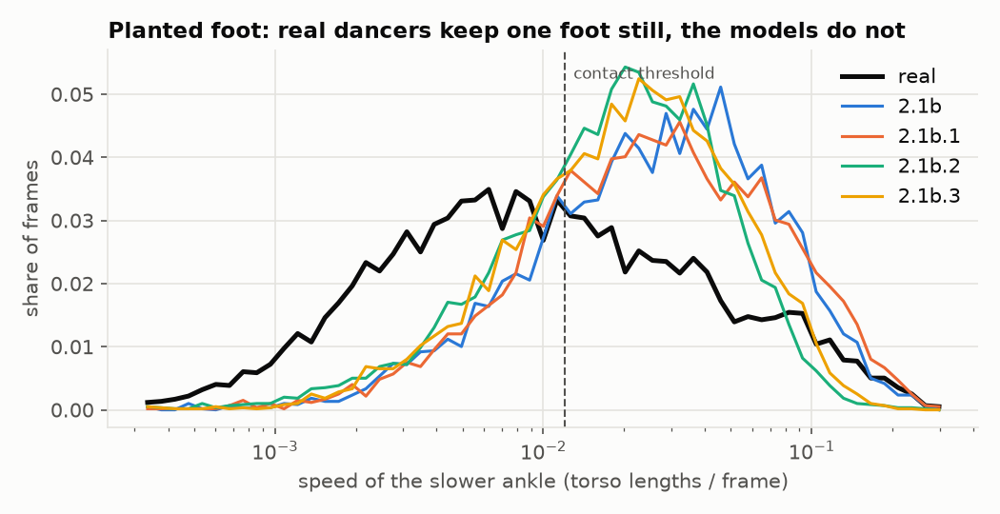

# Foot sliding and whole-body shifting

*Status as of 2026-11-20. Details and reproduction: [README.md](README.md) in this folder and
[`../2026-11-19_2.1b_variants/README.md`](../2026-11-19_2.1b_variants/README.md#whole-body-shifting-and-foot-sliding).*

## What we see

In the generated dances, the whole figure shifts around the screen (every joint moves together), and the feet
slide along the floor instead of staying planted. This happens in every model so far: 2.1b, 2.1b.1 (46.9M), and
2.1b.2 / 2.1b.3 (new energy loss).

## What we measured

Data: 10 held-out test songs (one per genre), 20 s each. Units: torso lengths per frame.

| | Real | 2.1b | 2.1b.1 | 2.1b.2 | 2.1b.3 |
|---|---:|---:|---:|---:|---:|
| Root speed (whole-body travel) | 0.035 | 0.037 | 0.039 | 0.029 | 0.032 |
| Root jitter (frame-to-frame change) | 0.014 | 0.021 | 0.020 | 0.016 | 0.019 |
| Speed of the slower ankle (median) | 0.014 | 0.030 | 0.031 | 0.022 | 0.024 |
| Frames with no foot planted | 44% | 77% | 76% | 70% | 71% |
| Ankle speed where the model says "planted" | 0.0095 | 0.040 | 0.030 | 0.026 | 0.029 |



## Diagnosis

- **The feet are the main problem.** Real dancers keep one foot still most of the time; the models rarely do.
  Even a foot the model itself marks as planted moves 3–4× faster than a real planted foot.
- **The "shifting" is root jitter, not too much travel.** Overall travel is about real, but the pelvis changes
  velocity 1.2–1.5× more from frame to frame than a real dancer's.
- **The foot loss we inherited from EDGE was effectively off.** It penalizes ankle motion only on frames where the
  model's *own* contact output says "planted", averaged over all frames. On a trained model it measured about 0.1%
  of the total loss, and the model can avoid it by not predicting contact.
- **Ruled out: stitching the long dances.** A 20 s dance is 150-frame windows that overlap by 75 frames and are
  cross-faded. Neighbouring windows disagree on the root by about 0.1 torso lengths. Spread over a 75-frame fade
  that is about 0.001 per frame, and root speed is no higher in the middle of the fades than elsewhere.
- **EDGE has the same problem.** It uses the same representation (absolute root position + contact flags) and the
  same foot loss, and its 3D output still slides. That is why the EDGE paper introduced the PFC foot-skating metric.

## Would 3D help?

Only partly. In 3D, "planted" becomes physical (the foot is on the ground plane), and moving toward the camera
would no longer look like body-size changes. But EDGE still slides in 3D, and root jitter and the weak contact loss
do not depend on dimension. Switching to AIST++ 3D would also drop the project's premise (learning from
single-camera 2D video). In a fixed-camera 2D video, a planted foot simply stops moving in the image, so the
problem can be measured and fixed directly in 2D.

## Fix 1: foot locking after sampling (done)

`python -m beat2body sample|evaluate ... --foot-lock --root-smooth 1` (`beat2body/model/footlock.py`). Where the
model marks a foot as planted, the body is shifted so that foot stays still. If both feet are planted, leg IK keeps
each foot where it landed (bone lengths kept). The correction fades in and out over a few frames, and the root is
smoothed over 1 frame. No retraining is needed.

Test songs, 769 windows:

| | Kinetic FID | Pose FID | PFC (real 0.032) | Slower-ankle speed (real 0.008) | No foot planted (real 40%) | Root jitter (real 0.0125) |
|---|---:|---:|---:|---:|---:|---:|
| 2.1b | 28.6 | 42.2 | 0.050 | 0.026 | 74% | 0.021 |
| 2.1b + lock | 31.6 | 42.3 | **0.030** | **0.009** | **47%** | 0.021 |
| 2.1b.2 | 22.0 | 22.5 | 0.046 | 0.019 | 65% | 0.016 |
| 2.1b.2 + lock + root smoothing | 23.6 | 22.5 | **0.023** | 0.002 | 37% | **0.012** |

Sliding drops to real levels, and pose FID and on-beat movement are unchanged. Kinetic FID gets slightly worse
(+1.5 to +3), because those features include root speed. On 2.1b.2 the feet end up slightly too planted, because
the model marks more frames as planted than a real dancer has.

## Fix 2: a foot loss that works, in training (running)

Models trained with this are the **4.x series**:

```
--foot-contact label --foot-weight 50 --root-accel-weight 5 --foot-max-t 500
```

- **Foot loss on the real dancer's contacts.** It penalizes ankle motion where the *real* dancer's foot is planted,
  averaged over those frames, and is about 15% of the total loss.
- **Root-acceleration loss.** The pelvis must speed up and slow down like the real dancer's, against jitter.
- **Both apply at low noise only** (diffusion step t < 500). Applied at every noise level (run 4.2-allt), they
  froze the dancer early in training: speed 0.13× real at 4k steps, against 0.50 for 2.1b.2. At high noise the
  model's estimate is a blur, and keeping its feet still means keeping everything still.

| Run | = | Training checks so far (8 val clips; speed / on-beat movement / body-size variation, real 0.140) |
|---|---|---|
| 4.2 | 2.1b.2 + fix 2 | 0.68 / **1.06** / 0.206, against 0.77 / 0.71 / 0.207 for 2.1b.2 |
| 4.1 | 2.1b.1 + fix 2 (46.9M) | at 14k steps 1.17 / 2.04 / 0.218, against 1.37 / 2.82 / 0.249 for 2.1b.1 |
| 4.2-allt | 4.2 with the losses at every noise level | 0.81 / 1.19 / 0.268 (recovered from the freeze; body size worse) |

The early sign is that planting the feet also raises on-beat movement: sliding becomes steps, which land on the
beat. This still needs the full test evaluation, with and without foot locking.

## Results so far (2026-11-20, test songs)

- **4.1** (46.9M + fix 2) is the most balanced model so far, with no post-processing: pose FID 25.1, on-beat
  movement 1.15, PFC 0.020, 33% of frames with no foot planted (real 40%), root jitter at real, normal stepping
  between contacts. Foot locking hurts it (kinetic FID 23.5 → 57), so use it raw.
- **4.2 / 4.2-allt / 4.3** (7.1M + fix 2 at weight 50) froze their feet (swing speed 0.004 vs 0.089 real, pose FID
  78–119). The weight is too high for the small model; aligning the labels did not help.
- Full table: [README.md](README.md#results-of-the-foot-fix-runs-2026-11-20).

## Open questions

- Do 4.1 and 4.2 reduce sliding on their own (without locking) on the test songs, and at what FID cost?
- Is foot locking still needed on top of fix 2, or does it now over-plant?
- 4.1 keeps the old energy loss and still overshoots on-beat movement (2× real at 14k steps). The next candidate
  is 4.2's settings at 46.9M.
- Contacts are defined by an ankle-speed threshold (0.012 torso lengths per frame). Pose-estimation noise in the
  real data sets a floor on how still a "planted" real foot looks.
